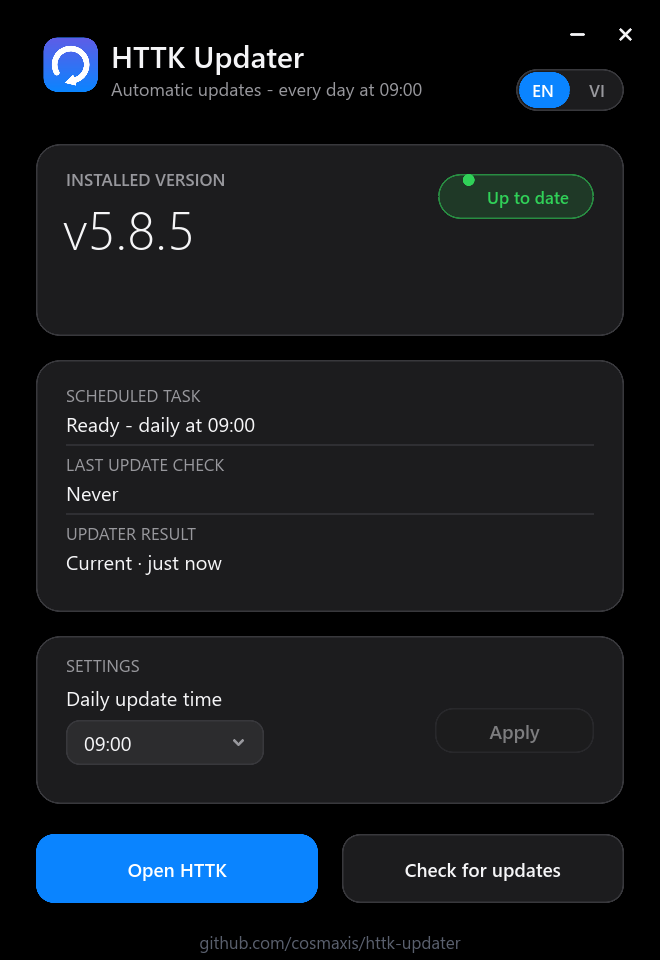
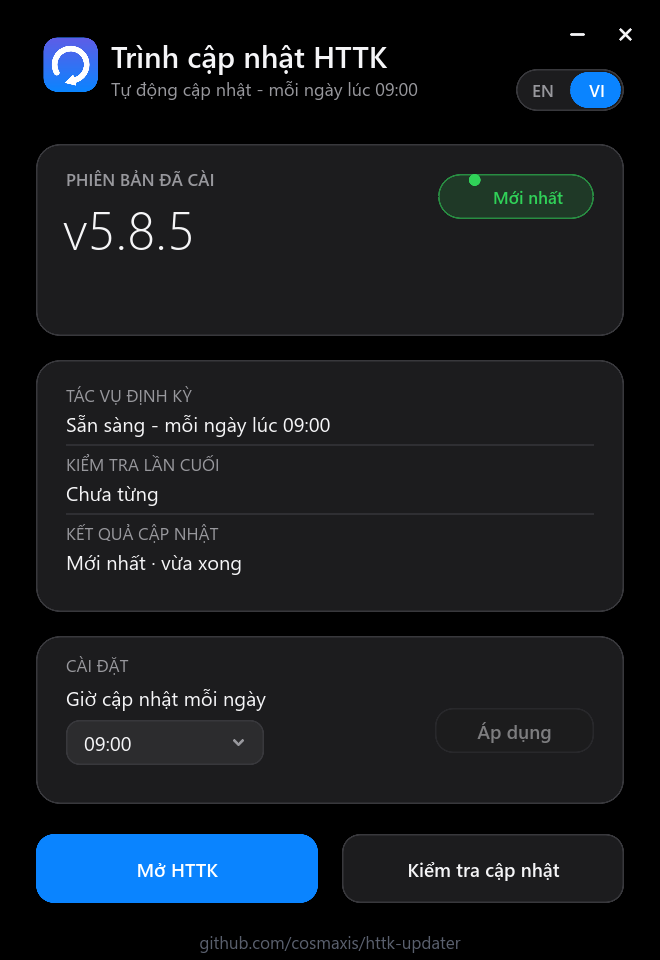
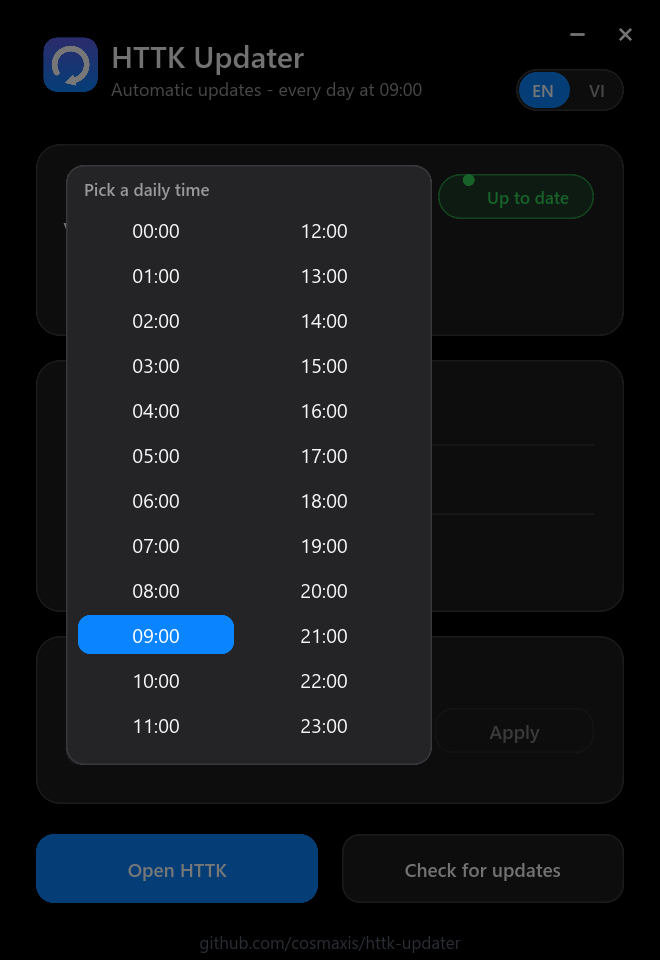

# HTTK Updater for Windows

[](https://github.com/cosmaxis/httk-updater/actions/workflows/test.yml)
[](https://github.com/cosmaxis/httk-updater/releases/latest)
[](LICENSE)
[](https://github.com/cosmaxis/httk-updater)
[](https://github.com/cosmaxis/httk-updater)

Keeps Vietnam's **HTTK** tax application updated to the latest official release — hands-free, one command, zero maintenance.

<p align="center">
  
  &nbsp;&nbsp;
  
</p>

## One-line install (any Windows machine)

Run in PowerShell — it self-elevates:

```powershell
irm https://raw.githubusercontent.com/cosmaxis/httk-updater/main/Install-HttkUpdater.ps1 | iex
```

That single command:

- Downloads and verifies the official **7-Zip 26.06** (SHA-256 pinned) used to unpack HTTK releases — no other dependencies.
- Installs **HTTK itself** if missing: discovers the latest release on the official [Cục Thuế page](https://www.gdt.gov.vn/wps/portal/home/hotrokekhai?1dmy&current=true&urile=wcm:path:/gdt+content/sa_gdt/htkk/soft_sup_declare), verifies the installer signature, installs silently.
- Registers the daily **"HTTK Daily Updater"** scheduled task (09:00, as the installing user) that checks for and installs newer signed releases.
- Drops an **HTTK launcher** on the desktop for all users — live status, settings, and manual update checks.

## The launcher

A **native Rust + Slint** desktop app — ~10 MB single exe, ~175 ms cold start, per-monitor DPI-aware, keyboard- and screen-reader-accessible, with native rounded corners on Windows 11. The original PowerShell launcher (`HttkLauncher.ps1`) remains as a fallback when the native exe isn't pinned/available.

- **Live status** — installed version, latest release, task state, last check, last update result
- **EN ⇄ VI** — single-click language switch, remembered per user
- **Adjustable schedule** — custom hour picker; Apply updates the daily task (one admin prompt)
- **Open HTTK** / **Check for updates** — one click each

<p align="center">
  
</p>

## How updates work

Each run (`Invoke-HttkUpdate.ps1`):

1. Verifies HTTK is not running and reads the installed version from `HTKK.exe.config`.
2. Scrapes the official page for the newest unambiguous release row and HTTPS download link.
3. Downloads with byte limits, extracts with the pinned 7-Zip, and requires both `HTKK.msi` and `setup.exe` to carry a valid signature from the pinned publisher certificate.
4. Backs up the whole install directory, restores it to a verification copy, and compares SHA-256 manifests — **before** touching the real install.
5. Uninstalls the registered MSI and installs the new one; aborts safely on reboot-required or failure and reports the backup location.
6. Writes `last-result.json` under `%ProgramData%\HttkUpdater` (shown by the launcher).

Status values: `Updated`, `Current`, `RebootRequired`, `Error` (with stage + message).

## Safety properties

- **No hard-coded versions** — the latest release is always discovered from the official page.
- **Publisher authenticity** — Authenticode + pinned certificate thumbprint on both installers.
- **Archive safety** — path/link validation, entry count and size limits, trusted-extractor-only extraction.
- **Failure-safe ordering** — backup and restore-verification complete before the real install is touched; a failed download never reaches the uninstall step.
- **Concurrency** — updates blocked while HTTK or its updater runs; a global mutex prevents concurrent runs.

## Files

| File | Purpose |
| --- | --- |
| `Install-HttkUpdater.ps1` | Single-click installer — scripts, 7-Zip, first HTTK install, task, desktop shortcut. `-Uninstall` removes the updater (not HTTK). |
| `Invoke-HttkUpdate.ps1` | One update run; used by the scheduled task and the launcher's update button. |
| `HttkUpdater.psm1` | Core module: release discovery, download, extraction, backup/verify, install. |
| `HttkLauncher.ps1` | Fallback desktop launcher (PowerShell/WinForms) used when the native exe isn't available. |
| `launcher/` | Native launcher: Rust + Slint source, unit tests, app manifest and icon. |
| `Test-HttkUpdater.ps1` | Offline test suite (20 cases) — no HTTK install or network needed. |

## Development

Requirements: Windows 10/11, PowerShell 5.1+. No dependencies beyond a hash-pinned 7-Zip the installer fetches itself.

```powershell
# Run the offline test suite (20 cases, self-contained temp dirs)
.\Test-HttkUpdater.ps1
```

CI runs the same suite plus a syntax check and a UTF-8 BOM check on every push — see [Actions](https://github.com/cosmaxis/httk-updater/actions).

> **Note:** `HttkLauncher.ps1` must keep its UTF-8 BOM — without it, Windows PowerShell 5.1 misreads the Vietnamese strings. CI enforces this.

### Native launcher

Prerequisites: Rust stable (`rustup`); the MSVC toolchain is recommended (CI builds with `stable-x86_64-pc-windows-msvc`; the GNU toolchain also works if `dlltool`/`windres` are on `PATH`).

```powershell
cd launcher
cargo test
cargo build --release
.\target\release\httk-launcher.exe --screenshot ..\docs\screenshot.png         # + -popup.png; add `--lang vi` for Vietnamese
```

Release process: bump `version` in `launcher/Cargo.toml`, tag `vX.Y.Z` — CI publishes `httk-launcher.exe` + `httk-launcher.exe.sha256` to the release — then set `$LauncherVersion`/`$LauncherSha256` in `Install-HttkUpdater.ps1` so new installs get the native launcher.

## Contributing

Issues and pull requests welcome. Please keep changes dependency-free — stock PowerShell for scripts; Rust + Slint for the launcher — and make sure `Test-HttkUpdater.ps1` stays green.

## Uninstall

```powershell
& "$env:ProgramData\HttkUpdater\bin\Install-HttkUpdater.ps1" -Uninstall
```

Removes the scheduled task, desktop shortcut, and `%ProgramData%\HttkUpdater`. HTTK itself is left installed.

## License

[MIT](LICENSE) © 2026 Cosmaxis

The launcher UI is built with [Slint](https://slint.dev) under the Slint Royalty-free Desktop License.

<a href="https://slint.dev"></a>
